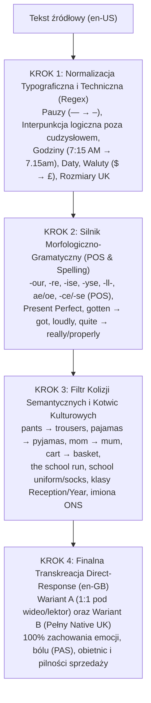

# Zasady Poprawnej Lokalizacji i Transkreacji Copywritingu Direct-Response: Amerykański Angielski (en-US) $\rightarrow$ Brytyjski Angielski (en-GB)

> [!IMPORTANT]
> **Nadrzędna Dyrektywa dla Agenta AI:**
> Celem procesu jest pełna adaptacja lingwistyczna, typograficzna i kulturowa tekstu reklamowego z rynku amerykańskiego (en-US) na rynek brytyjski (en-GB) przy **zachowaniu 100% siły sprzedażowej, ładunku emocjonalnego, ostrości punktów bólu (pain points), obietnic oraz pilności oferty (urgency)**. Agent **nie cenzuruje i nie łagodzi** przekazu reklamowego — zmienia wyłącznie kod językowy i ramy kulturowe tak, aby tekst brzmiał jak napisany od podstaw przez rodowitego brytyjskiego copywritera direct-response.

---

## 1. Fundamenty Psychologiczne: Zjawisko Asymetrii Percepcyjnej

Skuteczna adaptacja tekstów reklamowych direct-response (szczególnie Facebook Native Ads) z rynku amerykańskiego na rynek brytyjski wymaga znacznie głębszej interwencji niż prosta podmiana słownikowa. Z perspektywy psychologii konsumenckiej oraz badań użyteczności (m.in. Nielsen Norman Group) występuje zjawisko **asymetrii percepcyjnej**:

* **Konsumenci w USA** wykazują relatywnie wysoką tolerancję na brytyjskie warianty językowe (często kojarząc je z prestiżem).
* **Konsumenci w Wielkiej Brytanii** są wysoce wyczuleni na amerykanizmy. Obecność amerykańskiej pisowni, interpunkcji lub składni w reklamie kierowanej na rynek UK wywołuje jeden z dwóch negatywnych efektów:
  1. Odbiorca uznaje markę za nieprofesjonalną (zakładając, że tekst jest pełen literówek i błędów ortograficznych).
  2. Klasyfikuje reklamę jako zagraniczny dropshipping niedostosowany do lokalnych realiów logistycznych, co bezpośrednio obniża wiarygodność przekazu, CTR oraz współczynnik konwersji (ROAS).

Skuteczna lokalizacja opiera się na dwutorowym przetwarzaniu:
1. **Deterministycznej konwersji** reguł ortograficznych, mikrotypograficznych, gramatycznych oraz formatowania danych technicznych.
2. **Probabilistycznej transkreacji** rejestru pragmatycznego, kulturowych ram poznawczych (np. *the school run*, *school uniform*) oraz brytyjskiej kadencji zdaniowej.

---

## 2. Ortografia Systemowa i Morfologia Wyrazów (Spelling)

Różnice ortograficzne między en-US (dziewiętnastowieczne reformy Noaha Webstera dążące do fonetycznego uproszczenia pisowni) a en-GB (zachowanie form historycznych o korzeniach francuskich i klasycznych) mają charakter systemowy. Agent AI musi bezwzględnie konwertować poniższe wzorce morfologiczne oraz wyjątki leksykalne:

| Kategoria morfologiczna | Wzorzec amerykański (en-US) | Wzorzec brytyjski (en-GB) | Wyjątki i zasady implementacji dla Agenta AI |
| :--- | :--- | :--- | :--- |
| **Sufiks samogłoskowy (`-or` $\rightarrow$ `-our`)** | *color, behavior, honor, neighbor, favorite, flavor, humor, labor, rumor, vigor* | *colour, behaviour, honour, neighbour, favourite, flavour, humour, labour, rumour, vigour* | Bezwzględna konwersja tokenów. **Wyjątek:** w en-GB literę *u* opuszcza się przed przyrostkami `-ous`, `-ist`, `-ise`, `-ate` (np. *humorous, invigorate*, ale *odourless, colourful, favourite*). |
| **Sufiks nominalny / przestrzenny (`-er` $\rightarrow$ `-re`)** | *center, theater, caliber, fiber, liter, somber* | *centre, theatre, calibre, fibre, litre, sombre* | Zamiana w wyrazach pochodzenia romańskiego z zachowaniem wyjątków nazw własnych marek oraz słów pochodzenia germańskiego / wykonawców czynności (*teacher, mother, number, filter*). |
| **Dyferencjacja semantyczna: `Meter` vs `Metre`** | *meter* (zarówno jednostka długości, jak i urządzenie pomiarowe) | *metre* (jednostka długości: *cm, mm, metres*)<br>*meter* (urządzenie pomiarowe: *water meter, gas meter*) | Parsowanie kontekstowe przed transformacją: wymiar fizyczny to zawsze *metre*, natomiast licznik/aparatura pomiarowa zachowuje pisownię *meter*. |
| **Fleksja czasownikowa (`-ize/-yze` $\rightarrow$ `-ise/-yse`)** | *organize, realize, optimize, apologize, customizable, recognize, analyze, paralyze* | *organise, realise, optimise, apologise, customisable, recognise, analyse, paralyse* | Choć standard Oxford spelling dopuszcza `-ize`, w brytyjskich mediach społecznościowych i copywritingu komercyjnym standardem rynkowym jest `-ise` oraz bezwzględne `-yse` dla rdzeni `-lysis`. |
| **Rzeczowniki `-ense` $\rightarrow$ `-ence`** | *defense, offense, pretense* | *defence, offence, pretence* | Bezwzględna zamiana `s` na `c` w rzeczownikach. |
| **Dystynkcja kategorialna POS (`-ce` vs `-se`)** | *practice* (rzecz. i czas.)<br>*license* (rzecz. i czas.) | **Rzeczownik (`-ce`):** *practice, licence*<br>**Czasownik (`-se`):** *practise, license* | Weryfikacja gramatyczna (POS tagging): rzeczownik w en-GB wymaga zapisu przez `-ce` (*a medical practice, driving licence*), natomiast czasownik wymaga `-se` (*to practise, licensed*). |
| **Geminacja spółgłoski L (podwajanie `-l-`)** | *traveling, traveler, canceled, modeling, labeled, signaled, fueled, jewelry* | *travelling, traveller, cancelled, modelling, labelled, signalled, fuelled, jewellery* | W en-GB spółgłoska `l` po pojedynczej, krótkiej samogłosce podwaja się przed sufiksami `-ed`, `-ing`, `-er`, `-or` niezależnie od akcentu wyrazowego (w US tylko gdy akcent pada na ostatnią sylabę, np. *controlled*). |
| **Redukcja `-ll` w podstawach wyrazów** | *enroll, fulfill, appall, instill, skillful, willful* | *enrol, fulfil, appal, instil, skilful, wilful* | W bezokolicznikach i przymiotnikach podstawowych en-GB traci jedno `l`, ale odzyskuje podwójne `ll` po dodaniu sufiksu `-ed`/`-ing` (*enrolled, fulfilled, fulfilling*). |
| **Ligatury medyczne i naukowe (`e` $\rightarrow$ `ae/oe`)** | *pediatric, pediatrician, orthopedic, estrogen, anemia, diarrhea, gynecology* | *paediatric, paediatrician, orthopaedic, oestrogen, anaemia, diarrhoea, gynaecology* | Kluczowe w reklamach produktów zdrowotnych, suplementów i artykułów dziecięcych. |
| **Końcówki `-og` $\rightarrow$ `-ogue`** | *catalog, dialog, analog, monolog* | *catalogue, dialogue, analogue, monologue* | **Wyjątek:** w kontekście interfejsów komputerowych dopuszczalne *dialog box*. |
| **Dyferencjacja: `Program` vs `Programme`** | *program* (każde znaczenie) | *programme* (TV, treningowy, lojalnościowy, edukacyjny, szkolny)<br>*program* (wyłącznie kod / oprogramowanie komputerowe) | Słowo *program* w en-GB zachowuje pisownię amerykańską tylko w odniesieniu do software'u (*computer program*). |
| **Prefiksacja i zrosty (Hyphenation)** | *well being, non profit, counterintuitive, cooperate* | *well-being, non-profit, counter-intuitive, co-operate* | W en-GB występuje silna preferencja łącznika (dywizu) w przymiotnikach i rzeczownikach złożonych. |

### Lista bezwzględnych podmian leksykalno-ortograficznych (1:1)

| Amerykański (en-US) | Brytyjski (en-GB) | Uwagi kontekstowe |
| :--- | :--- | :--- |
| `pajamas` | `pyjamas` | Skrót: `PJs` lub `pj's`. Pisownia przez `a` to natychmiastowy sygnał obcej reklamy. |
| `mom / mommy / moms` | `mum / mummy / mums` | W dialektach północnej Anglii, Szkocji i Irlandii spotyka się również `mam`. |
| `gray` | `grey` | Np. *storm grey, charcoal grey* (kolory mundurków szkolnych). |
| `cozy` | `cosy` | Dotyczy również form pochodnych: *cosier, cosiest, cosiness*. |
| `skeptical / skeptic` | `sceptical / sceptic` | Bezwzględna zmiana `k` $\rightarrow$ `c`. |
| `check` (czek bankowy) | `cheque` | Czasownik *to check* (sprawdzać) zachowuje pisownię `check`. |
| `tire` (opona) | `tyre` | Czasownik *to tire* (męczyć się) oraz *tired* zachowują `i`. |
| `curb` (krawężnik) | `kerb` | Czasownik *to curb* (powstrzymywać) zachowuje `curb`. |
| `mold` (pleśń / forma) | `mould` | Bezwzględna zmiana `o` $\rightarrow$ `ou`. |
| `aging` | `ageing` | Zachowanie `e` przed `-ing` (np. *anti-ageing*). |
| `advisor` | `adviser` | W brytyjskim uzusie prasowym i oficjalnym preferowane `-er`. |
| `aluminum` | `aluminium` | Dodatkowa sylaba `-ium`. |
| `specialty` | `speciality` | W odniesieniu do specjalizacji / produktu specjalnego. |
| `math` | `maths` | Zawsze w formie liczby mnogiej (*maths*). |

---

## 3. Mikrotypografia, Interpunkcja i Formatowanie Techniczne (Warstwa Regex)

W reklamach natywnych na platformie Meta detale typograficzne pełnią funkcję podświadomego sygnału autentyczności. Amerykańskie przewodniki stylu (Chicago Manual of Style, AP) narzucają reguły sprzeczne z brytyjską tradycją wydawniczą (Oxford, Cambridge, The Guardian).

| Zagadnienie | Standard amerykański (en-US) | Standard brytyjski (en-GB) | Reguła formatowania dla Agenta AI |
| :--- | :--- | :--- | :--- |
| **Pauza narracyjna (Myślnik)** | `Słowo—słowo` lub `Słowo — słowo` (Em-dash: `—`, U+2014) | `Słowo – słowo` (Spaced en-dash: ` – `, U+2013) | **KRYTYCZNE:** Zamień każdą długą pauzę `—` na półpauzę `–` otoczoną pojedynczymi spacjami (`\w+—\w+` $\rightarrow$ `\w+ – \w+`). |
| **Logika cytowania (Interpunkcja logiczna)** | `"Tekst,"` `"Tekst."` (kropka i przecinek zawsze wewnątrz cudzysłowu) | `'Tekst',` `'Tekst'.` lub `"Tekst",` `"Tekst".` (kropka i przecinek na zewnątrz) | Przenieś kropki i przecinki poza cudzysłów zamykający, chyba że znak interpunkcyjny stanowi część pełnego, samodzielnego zdania cytowanego. |
| **Hierarchia cudzysłowów** | Zewnętrzny `"podwójny"`, wewnętrzny `'pojedynczy'` | Zewnętrzny `'pojedynczy'`, wewnętrzny `"podwójny"` (w social media akceptowany też podwójny, ale z interpunkcją na zewnątrz) | Domyślna konwersja nadrzędnego cudzysłowu na pojedynczy lub bezwzględne zachowanie interpunkcji na zewnątrz cudzysłowu. |
| **Tytuły i honoryfikaty** | `Mr.`, `Mrs.`, `Ms.`, `Dr.`, `St.` | `Mr`, `Mrs`, `Ms`, `Dr`, `St` | Usuń kropkę końcową zawsze wtedy, gdy ostatnia litera skrótu jest zarazem ostatnią literą pełnego wyrazu (*Mister $\rightarrow$ Mr, Doctor $\rightarrow$ Dr*). |
| **Skróty łacińskie** | `e.g.`, `i.e.`, `etc.` | `eg`, `ie`, `etc` | Usuń wewnętrzne i końcowe kropki. |
| **Przecinek oksfordzki (Serial Comma)** | Obligatoryjny przed *and/or* (`red, white, and blue`) | Pomijany w prostych wyliczeniach (`red, white and blue`) | Usuwaj przecinek przed spójnikiem `and` oraz `or` zamykającym wyliczenie, pozostawiając go wyłącznie wtedy, gdy jego brak wywołuje dwuznaczność. |
| **Format godzin (12h / 24h)** | `7:15 AM`, `9:30 PM`, `10:00 AM` (dwukropek, spacja, wielkie litery) | `7.15am`, `7.15 am`, `9.30pm`, `10am`, `7.30` lub `07:15` | Zamień dwukropek na pojedynczą kropkę, usuń spację (lub zostaw pojedynczą) i zamień `AM/PM` na małe litery `am/pm`. Przy pełnych godzinach usuwaj `:00` (`10:00 AM` $\rightarrow$ `10am`). |
| **Format daty** | Numeryczny: `MM/DD/YYYY` (`10/14/2026`)<br>Słowny: `Friday, January 16th, 2026` | Numeryczny: `DD/MM/YYYY` (`14/10/2026`)<br>Słowny: `Friday 16 January 2026` | Odwróć układ numeryczny; w zapisie słownym przenieś dzień przed miesiąc, usuń przecinki oraz końcówki porządkowe (`-st`, `-nd`, `-rd`, `-th`). |
| **Zakresy dni i dat** | `Monday through Friday` | `Monday to Friday` (lub `Monday–Friday`) | Zamień amerykański przyimek `through` na `to` (w en-GB `to` domyślnie obejmuje dzień końcowy). |
| **Waluta i nominały** | `\$20`, `50¢`, `\$20 bill` | `£20`, `50p`, `£20 note`, wysyłka `+p&p` | Zamień `\$` na `£`, centy (`¢`) na pensy (`p`), *bill* na *note*. W UK naturalne progi cenowe kończą się na `.95`, `.75`, `.50` oraz `.99` (np. `£9.95`, `£22.99`). |
| **System miar** | Stopy, cale, funty (lbs), mile | **Hybrydowy:** odległości drogowe w milach (*miles*), ale wymiary odzieży, długość skarpet i wzrost dzieci w systemie metrycznym (*cm, mm, metres*) | Konwertuj wymiary produktowe i krawieckie na system metryczny (`cm`, `mm`), zachowując mile dla dystansu drogowego (np. *1.6 miles to school*). |
| **Rozmiarówka odzieży i obuwia** | Skala US | **Odzież damska:** $\text{UK} = \text{US} + 4$ (US 2 $\rightarrow$ UK 6, US 6 $\rightarrow$ UK 10, US 10 $\rightarrow$ UK 14, US 18 $\rightarrow$ UK 22)<br>**Obuwie damskie:** $\text{UK} = \text{US} - 2.5$ (US 8.5 $\rightarrow$ UK 6, US 9 $\rightarrow$ UK 6.5)<br>**Obuwie męskie:** $\text{UK} = \text{US} - 0.5$ (US 9.5 $\rightarrow$ UK 9, US 10 $\rightarrow$ UK 9.5)<br>**Dziecięce:** skala UK child (*UK child 6–8.5, UK 9–12, UK 4–7*) | Przeliczaj rozmiary we wszystkich opisach produktów oraz w cytowanych recenzjach klientów (testimonials). |
| **Piętra i adresy (Royal Mail)** | `1st floor` (parter), `2nd floor` (1. piętro), `ZIP code`, `60-70-80` | `Ground floor` (parter), `1st floor` (1. piętro nad parterem), `Postcode` (`NW6 5JH`), sort code `60 70 80` | W adresach usuwaj przecinki na końcach linii, miasto pocztowe pisz wielkimi literami (`LONDON`), kod pocztowy (`Postcode`) umieszczaj w osobnej, ostatniej linii. |

---

## 4. Gramatyka, Składnia i Mechanika Czasów

Łączenie brytyjskiego słownictwa z amerykańską strukturą zdaniową to najczęstszy błąd automatycznych translatorów, który natychmiast zdradza nienatywne pochodzenie tekstu.

### 4.1. Czasy przeszłe: Present Perfect zamiast Past Simple
* W odniesieniu do niedawnych zdarzeń mających wpływ na teraźniejszość — szczególnie w obecności przysłówków **just, already, yet** — amerykański angielski używa czasu Past Simple, natomiast brytyjski angielski zdecydowanie preferuje **Present Perfect**:
  * `I just ate` $\rightarrow$ **`I've just eaten`**
  * `I just saw it` $\rightarrow$ **`I've just seen it`**
  * `Did you eat yet?` $\rightarrow$ **`Have you eaten yet?`**
  * `Your password changed` $\rightarrow$ **`Your password has been changed`**
  * `An error occurred` $\rightarrow$ **`An error has occurred`**
* W narracji przeszłej en-GB rygorystycznie utrzymuje czas **Past Perfect** (`had already`, `And the day hadn't even properly started yet`).

### 4.2. Eliminacja imiesłowu `gotten` oraz konstrukcja `have got`
* Amerykański imiesłów `gotten` nie istnieje w standardowym języku brytyjskim — zawsze zamieniaj go na **`got`** (`It has gotten worse` $\rightarrow$ **`It has got worse`**).
* W mowie potocznej zamiast amerykańskiego `I have to leave` / `Do you have a minute?` preferuj brytyjskie **`I've got to leave`** / **`Have you got a minute?`**.

### 4.3. Zgodność podmiotu zbiorowego z orzeczeniem (Collective Nouns)
* W en-US rzeczowniki zbiorowe (*family, team, board, staff, government, company*) są traktowane jako bezosobowy monolit w liczbie pojedynczej (`The family is`, `Our team is`).
* W en-GB w narracji storytellingowej rzeczowniki te postrzegane są przez pryzmat tworzących je ludzi i przyjmują czasownik oraz zaimki w **liczbie mnogiej**:
  * `The team is delighted` $\rightarrow$ **`The team are delighted`**
  * `My family was exhausted` $\rightarrow$ **`My family were exhausted`**

### 4.4. Czasowniki deleksykalne (`have` vs `take`) i nieregularne (`-t` vs `-ed`)
* W opisach codziennej rutyny domowej zamieniaj amerykański czasownik `take` na brytyjski **`have`**:
  * `take a bath` $\rightarrow$ **`have a bath`**
  * `take a shower` $\rightarrow$ **`have a shower`**
  * `take a nap` $\rightarrow$ **`have a nap`**
* Czasowniki odmieniające się w USA regularnie przez `-ed` przyjmują w brytyjskiej narracji potocznej i reklamowej formy zakończone na **`-t`**:
  * `learned` $\rightarrow$ **`learnt`**
  * `spelled` $\rightarrow$ **`spelt`**
  * `dreamed` $\rightarrow$ **`dreamt`**
  * `burned` $\rightarrow$ **`burnt`**
  * `spoiled` $\rightarrow$ **`spoilt`**
* Czasownik `fit` w czasie przeszłym w UK przyjmuje formę **`fitted`** (`They fit perfectly` $\rightarrow$ **`They fitted perfectly`**).

### 4.5. Pełne formy przysłówkowe (Brak Flat Adverbs)
* W USA normą potoczną są tzw. płaskie przysłówki (`Screaming so loud`, `Drive slow`). W brytyjskiej narracji pisanej należy stosować pełną formę przysłówkową z `-ly` (**`Screaming so loudly`**) oraz typowo brytyjskie modyfikatory rytmiczne takie jak **`properly`** (`hadn't even properly started yet`).

### 4.6. Krytyczna pułapka semantyczna słowa `quite`
* W USA `quite` przed zwykłym przymiotnikiem działa jak wzmacniacz i oznacza „bardzo” (`quite good` = świetny, bardzo dobry).
* W Wielkiej Brytanii `quite` przed stopniowalnym przymiotnikiem oznacza **„dość / umiarkowanie / przeciętnie”** (`quite good` = znośny, taki sobie, mogło być lepiej).
* **Zasada dla Agenta AI:** W tekstach reklamowych zamieniaj amerykańskie pozytywne `quite` na **`really`**, **`genuinely`** lub **`properly`** (z wyjątkiem przymiotników absolutnych, gdzie `quite right` lub `quite brilliant` oznacza „całkowicie”).

### 4.7. Składnia przyimkowa, czasowniki frazowe i spójniki

| Amerykański (en-US) | Brytyjski (en-GB) | Przykład w copy (en-GB) |
| :--- | :--- | :--- |
| `on the weekend` | **`at the weekend`** | *Wash them at the weekend.* |
| `fill out a form` | **`fill in a form`** | *Fill in the quick form below.* |
| `enroll in a course` | **`enrol on a course`** | *Enrol on our programme today.* |
| `cater to` | **`cater for`** | *Designed to cater for sensory needs.* |
| `play on a team` | **`play in a team`** | *He loves playing in a team.* |
| `write me` / `talk with` | **`write to me`** / **`talk to`** | *Talk to your child's teacher.* |
| `different than` | **`different from`** (lub `to`) | *Completely different from standard socks.* |
| `fork over / fork up` (wydać pieniądze) | **`fork out`** | *Without forking out a fortune.* |
| `rained out` (odwołane przez deszcz) | **`rained off`** | *Football practice was rained off.* |
| `one and a half years` | **`a year and a half`** | *For over a year and a half.* |
| `while` (jako spójnik kontrastu/czasu) | **`whilst`** (częste w narracji pisanej) | *Whilst I was trying to get ready for work.* |
| `toward, forward, afterward` | **`towards, forwards, afterwards`** | Zachowanie końcowego `-s` w przysłówkach kierunku. |

---

## 5. Baza Leksykalna: E-Commerce, Parenting, Edukacja i Codzienność

### 5.1. Odzież, Parenting i Produkty Sensoryczne (Krytyczne „False Friends”)

| Kategoria | Termin Amerykański (en-US) | Odpowiednik Brytyjski (en-GB) | Kontekst kulturowy i instrukcja dla Agenta AI |
| :--- | :--- | :--- | :--- |
| **Spodnie vs Bielizna (PUŁAPKA SEMANTYCZNA!)** | `pants` (spodnie zewnętrzne)<br>`underwear / panties / briefs` (bielizna) | **`trousers` / `school trousers` / `joggers`** (spodnie)<br>**`pants` / `knickers` / `undies`** (bielizna/majtki) | **KRYTYCZNE:** Słowo *pants* w Wielkiej Brytanii oznacza wyłącznie majtki (bieliznę). Zdanie *He refused to put on his pants* wywołuje w UK obraz dziecka biegającego bez majtek. Spodnie zewnętrzne to bezwzględnie **`trousers`**. |
| **Podkoszulek vs Kamizelka** | `undershirt` (podkoszulek)<br>`vest` (elegancka kamizelka) | **`vest`** (podkoszulek bieliźniany)<br>**`waistcoat`** (kamizelka na koszulę) | W UK *vest* to dziecięcy podkoszulek zakładany pod koszulę szkolną. |
| **Swetry i sukienki szkolne** | `sweater / pullover` (sweter)<br>`jumper` (sukienka na szelkach) | **`jumper`** (sweter)<br>**`pinafore` / `pinny`** (sukienka na szelkach) | W UK *jumper* (lub *school jumper*) to podstawowy sweter od mundurka szkolnego. |
| **Obuwie i pozostała garderoba** | `sneakers / tennis shoes`<br>`gym shoes` (szkolne)<br>`pantyhose`<br>`suspenders` (szelki do spodni)<br>`overalls` (ogrodniczki)<br>`onesie` (śpioszki)<br>`closet` (szafa ubraniowa) | **`trainers`**<br>**`plimsolls` / `pumps`**<br>**`tights`**<br>**`braces`** (w UK *suspenders* to damski pas do pończoch!)<br>**`dungarees`** (w UK *overalls* to kombinezon roboczy)<br>**`babygrow`**<br>**`wardrobe`** | Bezwzględna podmiana wszystkich nazw garderoby i mebli domowych. |
| **Akcesoria dziecięce i detale krawieckie** | `diaper`<br>`pacifier`<br>`stroller` (spacerówka)<br>`baby carriage` (głęboki wózek)<br>`crib` (łóżeczko)<br>`snap buttons` (zatrzaski)<br>`hair ties` (gumki do włosów)<br>`hug` (tulenie dziecka) | **`nappy`** (l.mn. `nappies`)<br>**`dummy`**<br>**`pushchair` / `buggy`**<br>**`pram`**<br>**`cot`**<br>**`poppers`**<br>**`bobbles`**<br>**`cuddle`** | W opisach ubrań sensorycznych i adaptacyjnych zatrzaski to *poppers*, metki przy szyi to *neck labels*, a wypukłe szwy na palcach to *toe seams*. |
| **Dyskurs sensoryczny i neuroróżnorodność** | `Special Needs / IEP`<br>`seamless socks / sensory-friendly socks` | **`SEN` / `SEND`** (*Special Educational Needs and Disabilities*), **`neurodivergent`**<br>**`seamless socks, bamboo socks, inside-out socks, toe seams`** | W UK rodzice dzieci z autyzmem, ADHD, SPD, OCD i PDA używają pojęcia *inside-out socks* (skarpet wywracanych na lewą stronę w celu uniknięcia ucisku szwów na palce). |
| **Emocje, pośpiech i frustracja rodzicielska** | `rattled / stressed out`<br>`hassle / wasting time / lollygag`<br>`annoyance / pet peeve`<br>`throwing a fit` | **`frazzled` / `rattled` / `at my wits' end` / `worn down`**<br>**`faff` / `faffing about` / `fuss`** (*no added fuss*)<br>**`bugbear`**<br>**`meltdown` / `full-blown meltdown` / `tantrum` / `sensory overload`** | Słowo **`faff`** (*no faffing about, leads to the most faff*) oraz **`frazzled`** to najsilniejsze markery autentycznego języka brytyjskich matek na forach Mumsnet i r/UKParenting. |

### 5.2. Kotwice Kulturowe Brytyjskiego Poranka: „The School Run” i „School Uniform”

Poranna rutyna w Wielkiej Brytanii jest zorganizowana wokół dwóch potężnych instytucji kulturowych, które decydują o sile rezonansu emocjonalnego reklamy:

1. **`The school run`:**
   * Zwięzły, silnie naładowany emocjonalnie idiom określający całą poranną logistykę szykowania dzieci, pakowania tornistrów i odprowadzania/odwożenia ich do szkoły pod presją czasu (statystycznie najbardziej stresująca część dnia dla 52% rodziców w UK, obejmująca średnio 1,6 mili w korkach lub pieszo).
   * Wszelkie amerykańskie konstrukcje typu *getting ready for school*, *morning drop-off* czy *running late for school* należy transkreować do **`running late for the school run`** lub **`before the school run`**.
   * **Harmonogram brytyjskiego poranka:** Pobudka 6.30am–7.15am (często przy kanale telewizyjnym *CBeebies* wyznaczającym rytm poranka), wyjście na poranną świetlicę śniadaniową (**`breakfast club`**) o 7.30am–7.45am lub wyjście z domu o 8.15am–8.30am, aby zdążyć na otwarcie bram szkolnych (**`school gates`**) o 8.40am.
2. **`School uniform`:**
   * W przeciwieństwie do większości publicznych szkół w USA, w Wielkiej Brytanii niemal każda szkoła podstawowa i średnia (już od 4. roku życia — **Reception**) egzekwuje rygorystyczne polityki mundurkowe.
   * Mundurek obejmuje twarde, skórzane półbuty (**`formal school shoes`**), sztywne spodnie (**`school trousers`**), koszule oraz skarpety (**`school socks`**) lub rajstopy (**`tights`**) w regulaminowych kolorach: szarym (*storm grey / charcoal grey*), czarnym (*black*), granatowym (*navy*) lub białym (*white*).
   * Połączenie sztywnego obuwia szkolnego z grubymi szwami tradycyjnych skarpet mundurkowych stanowi główny wyzwalacz zjawiska znanego w UK jako **`sock meltdowns before the school run`**.

### 5.3. System Edukacji i Demografia (Szkoła oraz Imiona ONS)

| Wiek dziecka | System Amerykański (en-US) | System Brytyjski (en-GB) | Wzór i uwagi dla Agenta AI |
| :--- | :--- | :--- | :--- |
| **3–4 lata** | `Daycare / Preschool / Pre-K` | **`Nursery`** | Przedszkole / żłobek. |
| **4–5 lat** | `Pre-K / Junior K` | **`Reception`** | Pierwszy rok formalnej szkoły podstawowej (**Primary School**) — dzieci noszą już obowiązkowe mundurki! |
| **5–6 lat** | `Kindergarten` | **`Year 1`** | Początek Key Stage 1 (KS1). |
| **6–11 lat** | `Elementary School` (`1st Grade` – `5th Grade`) | **`Primary School`** (**`Year 2` – `Year 6`**) | Przelicznik: $\text{UK Year} = \text{US Grade} + 1$ (np. *4th Grade* $\rightarrow$ *Year 5*). *Year 6* kończy się egzaminami *KS2 SATs*. |
| **11–16 lat** | `Middle School` (`6th–8th Grade`) & `High School` (`9th–10th Grade`) | **`Secondary School`** (**`Year 7` – `Year 11`**) | Przelicznik: $\text{UK Year} = \text{US Grade} + 1$. *Year 11* (wiek 16 lat) kończy się egzaminami **GCSE**. |
| **16–18 lat** | `High School Junior / Senior` (`11th–12th Grade`) | **`Sixth Form` / `FE College`** (**`Year 12` – `Year 13`**) | Kończy się maturą **A-Levels**. |

* **Słownictwo szkolne (Krytyczne podmiany):**
  * `Public school` (US: bezpłatna szkoła publiczna) $\rightarrow$ **`State school`** (w UK *public school* oznacza elitarną, płatną szkołę prywatną z czesnym!).
  * `Principal` $\rightarrow$ **`Headteacher`**; `Student` (w szkole podstawowej/średniej) $\rightarrow$ **`Pupil`**; `PE clothes / gym clothes` $\rightarrow$ **`PE kit`**.
  * `Fall / Spring Semester` $\rightarrow$ **`Autumn / Spring / Summer Term`** (3 trymestry przedzielone tygodniową przerwą w połowie każdego trymestru zwaną **`half-term`**).
  * `Crossing guard` $\rightarrow$ **`Lollipop man` / `Lollipop lady`**.
* **Podmiana imion w storytellingu (według statystyk ONS UK):**
  * Usuwaj typowo amerykańskie imiona (*Brody, Hunter, Maverick, Wrenley, Navy, Azari, Peyton, Tanner*) i zastępuj je brytyjskimi odpowiednikami z czołówki ONS:
  * **Chłopcy:** *Arthur, Archie, George, Oliver, Noah, Leo, Luca, Oscar, Jude, Rory, Louis, Theo, Freddie, Alfie*.
  * **Dziewczynki:** *Olivia, Amelia, Lily, Isla, Ivy, Florence, Freya, Poppy, Elsie, Ava, Daisy, Phoebe, Rosie, Millie, Matilda, Maisie, Lottie, Imogen, Orla, Ottilie*.

### 5.4. E-Commerce UI/UX, Dom, Transport, Jedzenie, Biznes i Idiomy

| Kategoria | Termin Amerykański (en-US) | Odpowiednik Brytyjski (en-GB) | Kontekst użycia |
| :--- | :--- | :--- | :--- |
| **E-Commerce & Checkout** | `Cart / Shopping cart` (online)<br>`Shopping cart` (w sklepie stacjonarnym)<br>`Shipping / Freight`<br>`Store pickup / Curbside pickup`<br>`Inventory` | **`Basket` / `Shopping basket`**<br>**`Trolley`**<br>**`Delivery` / `Postage` / `P&P`**<br>**`Click & Collect`**<br>**`Stock`** | CTA i komunikaty: *Add to basket, View basket, Standard delivery, Next-day delivery, Postage and packaging, In stock, Out of stock*. |
| **Zdrowie i Apteka** | `ER (Emergency Room)`<br>`drugstore / pharmacy`<br>`Band-Aid`<br>`Q-tip / cotton swab` | **`A&E (Accident and Emergency)`**<br>**`chemist` / `pharmacy`**<br>**`plaster`**<br>**`cotton wool bud`** | Opis sytuacji nagłych, higieny i pierwszej pomocy. |
| **Dom i Zakupy** | `apartment`<br>`elevator`<br>`faucet`<br>`trash / garbage`<br>`flashlight`<br>`eraser`<br>`grocery store`<br>`TV` | **`flat`**<br>**`lift`**<br>**`tap`**<br>**`rubbish` / `bin`**<br>**`torch`**<br>**`rubber`**<br>**`supermarket` / `the shops`** (np. *Tesco's, M&S, Sainsbury's, Primark*)<br>**`telly` / `TV`** | Codzienne sceny domowe w storytellingu. |
| **Droga i Samochód** | `sidewalk`<br>`parking lot`<br>`highway / freeway`<br>`subway`<br>`truck`<br>`trunk` (bagażnik)<br>`hood` (maska)<br>`windshield` | **`pavement`**<br>**`car park`**<br>**`motorway`**<br>**`Underground` / `Tube`**<br>**`lorry`**<br>**`boot`**<br>**`bonnet`**<br>**`windscreen`** | Sceny w drodze do szkoły (*the school run*) i podróży. |
| **Jedzenie i Napoje** | `oatmeal`<br>`cookies`<br>`chips` (w paczce)<br>`French fries / fries`<br>`candy`<br>`cotton candy`<br>`popsicle`<br>`soda`<br>`eggplant`<br>`zucchini` | **`porridge`**<br>**`biscuits`**<br>**`crisps`**<br>**`chips`**<br>**`sweets`**<br>**`candyfloss`**<br>**`ice lolly`**<br>**`fizzy drink`**<br>**`aubergine`**<br>**`courgette`** | Poranne śniadania dzieci (*porridge*) i przekąski. |
| **Praca i Finanse** | `resume`<br>`layoff`<br>`to fire / terminate`<br>`checking account`<br>`stockholder`<br>`schedule` | **`CV`**<br>**`redundancy`**<br>**`to sack`**<br>**`current account`**<br>**`shareholder`**<br>**`timetable`** | Kontekst zawodowy i finansowy rodziców. |
| **Idiomy i Slang** | `awesome`<br>`dude / bro`<br>`throw a monkey wrench into`<br>`wouldn't touch it with a ten-foot pole`<br>`tempest in a teapot`<br>`take it with a grain of salt`<br>`sweep under the rug`<br>`green thumb`<br>`put your two cents in` | **`ace` / `brilliant` / `spot on`**<br>**`bloke` / `mate`**<br>**`put a spanner in the works`**<br>**`wouldn't touch it with a bargepole`**<br>**`a storm in a teacup`**<br>**`take it with a pinch of salt`**<br>**`sweep under the carpet`**<br>**`green fingers`**<br>**`put your two penn'orth (tuppence worth) in`** | Naturalne zwroty potoczne w kreacjach UGC i postach natywnych. |

---

## 6. Psychologia Perswazji, Tonalność i Konwencje Meta Ads w UK

1. **Pełna siła emocjonalna + brytyjski realizm językowy:**
   * Agent AI **zachowuje 100% napięcia emocjonalnego, dramatyzmu sytuacji (PAS: Problem–Agitate–Solution), punktów bólu, pilności (urgency/scarcity) i obietnic sprzedażowych** z tekstu źródłowego.
   * Różnica polega wyłącznie na zastąpieniu sztucznego, plastikowego, „telezakupowego” tonu amerykańskiego autentycznym językiem brytyjskiego rodzica (używanie wyrażeń takich jak *completely frazzled*, *at my wits' end*, *full-blown meltdown*, *no faffing about*, *no extra cost, no added fuss*, *sorted out without fuss*, *making mornings that little bit easier*).
2. **Kalibracja Call to Action (CTA) pod format kreacji:**
   * **W postach natywnych / storytellingowych (Top of Funnel):** Wysoką skuteczność osiągają naturalne wezwania eksploracyjne: *Find out more, See the range, Explore the collection, Shop seamless socks*.
   * **W reklamach ofertowych / direct-response (Middle/Bottom of Funnel):** Pełna dynamika zakupowa z brytyjską terminologią koszyka i dostawy: *Add to basket, Claim your bundle today, Order now for next-day delivery*.
3. **Lokalizacja Dowodu Społecznego (Social Proof):**
   * Obok dowodów wolumetrycznych (*Over 50,000 UK mums...*), najwyższą konwersję w UK zapewniają odwołania do lokalnych grup i autorytetów: społeczności **Mumsnet**, **r/UKParenting** oraz brytyjskich terapeutów zajęciowych (**UK Occupational Therapists – OTs**).

---

## 7. Matryca Reguł Decyzyjnych dla Agenta AI (Baza IF–THEN)

| ID Reguły | Warunek Wejściowy w Tekście Źródłowym (IF en-US) | Transformacja Docelowa (THEN en-GB) | Uzasadnienie Analityczne i Kontekstowe |
| :--- | :--- | :--- | :--- |
| **`RULE_TYP_01`** | Wystąpienie długiej pauzy `—` (bez spacji lub ze spacjami). | Zamień na półpauzę otoczoną pojedynczymi spacjami: ` – `. | Standard typograficzny w UK wymaga *spaced en-dash* zamiast *em-dash*. |
| **`RULE_TYP_02`** | Zapis godziny w formacie `H:MM AM/PM` lub `H:MM` w narracji. | Zamień na `H.MMam/pm` lub `H.MM` (np. `7.15am`, `7.30`, `10am`). | W brytyjskiej narracji i wpisach rodzicielskich kropka jest naturalnym separatorem godzin i minut. |
| **`RULE_TYP_03`** | Kropka lub przecinek przed cudzysłowem zamykającym frazę (`"text."` lub `"text,"`). | Przenieś znak interpunkcyjny poza cudzysłów (`'text'.` lub `"text",`). | Zastosowanie brytyjskiej zasady interpunkcji logicznej. |
| **`RULE_TYP_04`** | Tytuły z kropką (`Mr.`, `Mrs.`, `Ms.`, `Dr.`), skróty (`e.g.`, `i.e.`) oraz przecinek oksfordzki. | Usuń kropki (`Mr`, `Mrs`, `Ms`, `Dr`, `eg`, `ie`) oraz zbędny przecinek przed `and`/`or`. | Zgodność z brytyjską normą redakcyjną. |
| **`RULE_TYP_05`** | Waluta `\$`, daty `MM/DD/YYYY`, rozmiary US, przyimek `through` w zakresach. | Zamień na `£`, daty `DD/MM/YYYY` (lub `16 January 2026`), przelicz rozmiary na UK, zmień `through` na `to`. | Eliminacja twardych błędów lokalizacyjnych. |
| **`RULE_ORT_01`** | Słowo `pajamas` (w dowolnej wielkości liter). | Zamień bezwarunkowo na `pyjamas` (lub `PJs` przy skrócie). | Pisownia przez `a` jest natychmiast rozpoznawalnym błędem amerykanizacyjnym w UK. |
| **`RULE_ORT_02`** | Słowo `mom`, `mommy`, `moms`. | Zamień bezwarunkowo na `mum`, `mummy`, `mums`. | Podstawowy marker tożsamości kulturowej w reklamach rodzicielskich w UK. |
| **`RULE_ORT_03`** | Końcówki `-or`, `-er`, `-ize`, `-yze`, `-ense`, `-og`, pojedyncze `-l-` przy sufiksach, uproszczone `e` w terminach medycznych. | Konwertuj na `-our`, `-re`, `-ise`, `-yse`, `-ence`, `-ogue`, `-ll-` (`travelling`), `ae/oe` (`paediatric`) oraz rozróżniaj POS `-ce/-se` (`practice/practise`). | 100% zgodności ze słownikiem brytyjskim (z zachowaniem wyjątków `meter` jako licznik i `computer program`). |
| **`RULE_GRM_01`** | Past Simple z `just/already/yet`, imiesłów `gotten`, `take a bath/shower`, płaskie przysłówki (`screaming so loud`), amerykańskie `quite`. | Zmień na Present Perfect (`I've just`), `got`, `have a bath/shower`, pełny przysłówek (`loudly`), a `quite` zamień na `really/genuinely/properly`. | Naturalna brytyjska gramatyka i uniknięcie osłabienia znaczenia przez brytyjskie *quite*. |
| **`RULE_LEX_01`** | Słowo `pants` oznaczające długie spodnie zewnętrzne. | Zamień bezwzględnie na `trousers` (lub `school trousers` / `joggers`). | Uniknięcie katastrofalnego błędu semantycznego (*pants* w UK to majtki). |
| **`RULE_LEX_02`** | Kontekst porannego odwożenia/odprowadzania dzieci do szkoły (`late for school`, `morning drop-off`). | Wprowadź idiom `the school run` (np. `running late for the school run`, `before the school run`). | Zwrot *the school run* to najsilniejszy wyzwalacz emocjonalny dla brytyjskich rodziców. |
| **`RULE_LEX_03`** | Kontekst skarpetek/ubrań do szkoły oraz wieku szkolnego w reklamie dziecięcej. | Uwzględnij `school socks`, `school uniform`, `school trousers`, klasy `Nursery / Reception / Year 1–13`, `State school` oraz `SEN/SEND`. | Osadzenie reklamy w realiach obowiązkowych mundurków szkolnych w UK. |
| **`RULE_LEX_04`** | Opis porannego zamieszania, frustracji i terminologia e-commerce (`cart`, `shipping`, `rattled`, `hassle`). | Użyj brytyjskich odpowiedników: `basket`, `delivery`, `frazzled`, `faff / faffing about`, `no added fuss` oraz brytyjskich imion ONS. | Pełna autentyczność w oczach brytyjskiego konsumenta. |

---

## 8. Czteroetapowy Pipeline Przetwarzania dla Agenta AI

Aby wyeliminować zjawisko dryfu lingwistycznego (w którym model LLM zamienia *color* na *colour*, ale w tym samym zdaniu zostawia amerykańską pauzę `—` lub godzinę `7:15 AM`), agent realizuje proces w 4 sekwencyjnych krokach:



---

## 9. Wzorcowa Transkreacja Referencyjna (Case Study: Sensory Socks Ad)

Poniższe zestawienie prezentuje dwa warianty wyjściowe generowane przez Agenta AI:
* **Wariant A (Lokalizacja Konserwatywna 1:1):** Przeznaczony do sytuacji, w których tekst musi idealnie pokrywać się z gotowym nagraniem lektorskim lub napisami wideo (wprowadza wyłącznie niezbędne korekty ortograficzne, interpunkcyjne, gramatyczne i formatowania).
* **Wariant B (Pełna Transkreacja Kulturowa Direct-Response):** Przeznaczony dla kreacji tekstowych i natywnych postów Meta Ads — adaptuje przekaz do autentycznego języka i realiów brytyjskiego poranka (*the school run*, *school socks*, *school trousers*), zachowując pełne napięcie emocjonalne oryginału.

### Zestawienie Porównawcze (Wiersz po Wierszu)

| Wers | Oryginał Amerykański (en-US) | Wariant A: Lokalizacja Konserwatywna (en-GB 1:1) | Wariant B: Pełna Transkreacja Kulturowa (en-GB Native) | Zastosowana Reguła i Uzasadnienie |
| :--- | :--- | :--- | :--- | :--- |
| **1** | The screaming started over socks. | The screaming started over socks. | The screaming started over a pair of school socks. | `RULE_LEX_03`: Natychmiastowe odwołanie do skarpetek od brytyjskiego mundurka szkolnego w pierwszym zdaniu (hooku). |
| **2** | Not itchy socks. Not dirty socks. | Not itchy socks. Not dirty socks. | Not itchy socks. Not dirty socks. | Brak zmian – paralelizm składniowy naturalny w obu odmianach. |
| **3** | Just… socks. | Just… socks. | Just… socks. | Zachowanie wielokropka budującego napięcie narracyjne. |
| **4** | It was 7:15 AM. | It was 7.15am. | It was 7.15am. | `RULE_TYP_02`: Konwersja dwukropka na kropkę, usunięcie spacji i małe litery `am`. |
| **5** | We were already running late for school. | We were already running late for school. | We were already running late for the school run. | `RULE_LEX_02`: Wprowadzenie kluczowego brytyjskiego idiomu *the school run*. |
| **6** | One second he was fine. | One second he was fine. | One second he was fine. | Brak zmian. |
| **7** | The next — full meltdown. | The next – full meltdown. | The next – a full-blown meltdown. | `RULE_TYP_01`: Zamiana amerykańskiej pauzy `—` na brytyjską półpauzę ze spacjami ` – ` oraz naturalne wzmocnienie *a full-blown meltdown*. |
| **8** | Crying. | Crying. | Crying. | Brak zmian. |
| **9** | Kicking. | Kicking. | Kicking. | Brak zmian. |
| **10** | Screaming so loud my other kids covered their ears. | Screaming so loudly my other kids covered their ears. | Screaming so loudly the other two had their hands over their ears. | `RULE_GRM_01`: Pełna forma przysłówkowa *loudly* oraz naturalna fraza z brytyjskiego rejestru rodzinnego. |
| **11** | By 7:30, we were all rattled. | By 7.30, we were all rattled. | By 7.30, we were all completely frazzled. | `RULE_TYP_02` & `RULE_LEX_04`: Zmiana `7:30` $\rightarrow$ `7.30` oraz zastąpienie *rattled* autentycznym brytyjskim *completely frazzled*. |
| **12** | He was still in his pajamas. | He was still in his pyjamas. | He was still in his pyjamas, refusing to put his school trousers on. | `RULE_ORT_01` & `RULE_LEX_01`: Bezwzględna konwersja *pajamas* $\rightarrow$ *pyjamas* oraz dodanie kontekstu spodni mundurkowych (*school trousers*). |
| **13** | I was sweating and fighting back tears. | I was sweating and fighting back tears. | I was sweating, clock-watching and fighting back tears. | Pełne zachowanie somatycznego napięcia (*sweating*) z dodaniem *clock-watching* podbijającym presję czasu przed *the school run*. |
| **14** | And the day hadn’t even started yet. | And the day hadn’t even started yet. | And the day hadn’t even properly started yet. | `RULE_GRM_01`: Zachowanie czasu Past Perfect z dodaniem brytyjskiego modyfikatora potocznego *properly*. |

---

### Gotowe Bloki Tekstowe (Wariant A i Wariant B)

#### Wariant A: Lokalizacja Konserwatywna (1:1)
```text
The screaming started over socks.
Not itchy socks. Not dirty socks.
Just… socks.

It was 7.15am.
We were already running late for school.
One second he was fine.
The next – full meltdown.

Crying.
Kicking.
Screaming so loudly my other kids covered their ears.

By 7.30, we were all rattled.
He was still in his pyjamas.
I was sweating and fighting back tears.
And the day hadn’t even started yet.
```

#### Wariant B: Pełna Transkreacja Kulturowa Direct-Response (Rekomendowana dla UK Meta Ads)
```text
The screaming started over a pair of school socks.
Not itchy socks. Not dirty socks.
Just… socks.

It was 7.15am.
We were already running late for the school run.
One second he was fine.
The next – a full-blown meltdown.

Crying.
Kicking.
Screaming so loudly the other two had their hands over their ears.

By 7.30, we were all completely frazzled.
He was still in his pyjamas, refusing to put his school trousers on.
I was sweating, clock-watching and fighting back tears.
And the day hadn’t even properly started yet.
```
